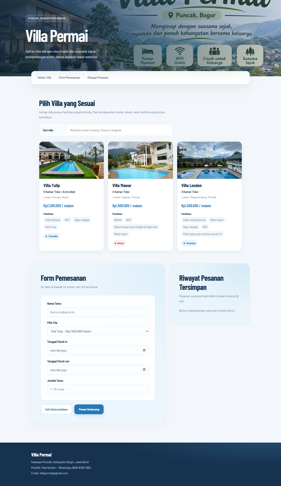
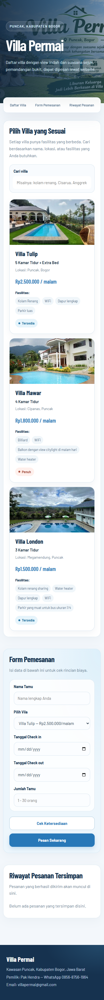
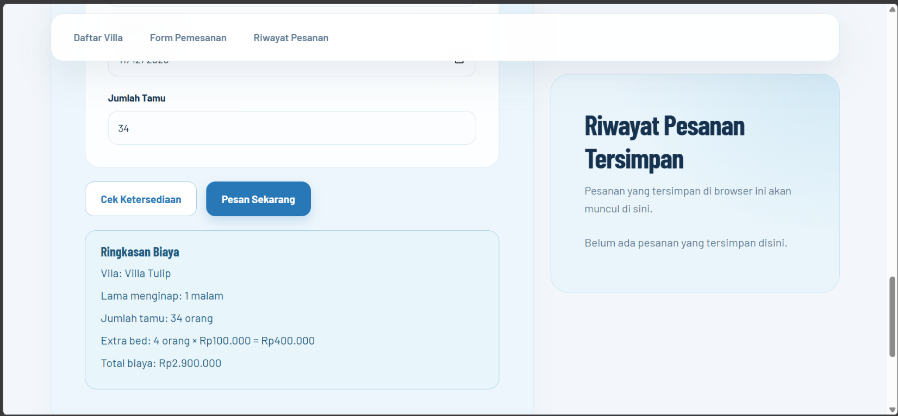
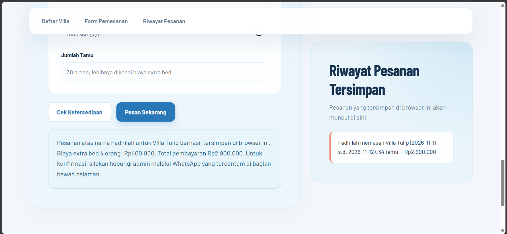

# Villa Permai — Aplikasi Pemesanan Vila Berbasis Web

Halaman web statis untuk Villa Permai, usaha penyewaan tiga unit vila di kawasan Puncak, Kabupaten Bogor. Dibuat agar calon tamu bisa mengecek ketersediaan, melihat perkiraan biaya, dan mengirim pesanan sendiri tanpa harus tanya jawab manual lewat WhatsApp.

## Identitas

- **Nama:** Fadhilah Ramadhan Arrayyan
- **NIM:** 24011130518
- **Repository:** https://github.com/arrayya/FadhilahRamadhanArrayyan_24011130518_uts.git

## Struktur Proyek

```
uts-vila-permai/
├── index.html
├── style.css
├── script.js
├── README.md
├── .gitignore
└── assets/
    ├── permai.png
    ├── tulip.jpg
    ├── mawar.jpg
    ├── london.jpg
    ├── screenshot-desktop.png
    └── screenshot-mobile.png
```

Tidak ada back-end maupun basis data. Seluruh data tiga vila (nama, tipe kamar, lokasi, harga, fasilitas, status ketersediaan) disimpan sebagai array objek di dalam `script.js` dan dirender ke halaman memakai `createElement` dan `appendChild`.

## Cara Menjalankan

Buka file `index.html` langsung di browser, atau jalankan lewat live server (misalnya ekstensi Live Server di VS Code) agar path relatif ke `style.css` dan `script.js` terbaca dengan baik.

## Fitur Utama

- Daftar tiga vila ditampilkan sebagai kartu, lengkap dengan status tersedia/penuh.
- Pencarian/filter vila berdasarkan nama, lokasi, atau fasilitas.
- Form pemesanan dengan dua tombol: **Cek Ketersediaan** (menampilkan ringkasan biaya tanpa mengirim pesanan) dan **Pesan Sekarang** (mengirim sekaligus menyimpan pesanan).
- Validasi input berbahasa Indonesia: nama wajib diisi, vila wajib dipilih, tanggal check-out harus setelah check-in, tanggal tidak boleh di masa lalu, dan jumlah tamu minimal 1 orang. Kapasitas normal 30 orang; tamu selebihnya dikenai biaya extra bed Rp100.000 per orang.
- Nama tamu terakhir dan riwayat pesanan disimpan di `localStorage`, sehingga tetap muncul saat halaman dibuka ulang di perangkat yang sama.
- Tampilan responsif dengan breakpoint 900px dan 640px: tata letak kartu, formulir, dan navigasi menyesuaikan ukuran layar.

## Laporan Hasil Pengerjaan — Tampilan Website

Website telah ditampilkan dan didokumentasikan dalam tangkapan layar satu halaman penuh. Versi desktop menggunakan viewport 1440px, sedangkan versi mobile menggunakan viewport 390px.

| Tampilan | Ukuran viewport | Screenshot |
|---|---:|---|
| Desktop | 1440px | [screenshot-desktop.png](assets/screenshot-desktop.png) |
| Mobile | 390px | [screenshot-mobile.png](assets/screenshot-mobile.png) |

<details>
<summary>Pratinjau screenshot desktop</summary>
<p></p>
</details>

<details>
<summary>Pratinjau screenshot mobile</summary>
<p></p>
</details>

### Contoh Alur Pemesanan

1. **Cek ketersediaan dan rincian biaya:** customer memeriksa total biaya vila sebelum memesan.

   

2. **Pemesanan berhasil:** setelah yakin, customer memesan vila dan melihat konfirmasi serta pesanan tersimpan di riwayat.

   

## Logika Perhitungan Harga

Total biaya dihitung dengan fungsi `hitungTotalHarga()`:

```
total = (harga per malam × jumlah malam) + biaya extra bed
```

Kapasitas normal adalah 30 orang. Setiap tamu di atas kapasitas tersebut dikenai biaya extra bed Rp100.000 per orang, sekali per pemesanan.

## Riwayat Commit

Riwayat commit disusun bertahap mengikuti tahapan pengerjaan berikut:

1. `init: struktur HTML dasar halaman Villa Permai`
2. `style: tambah styling dasar dan tata letak responsif`
3. `feat: render data vila dan form pemesanan dengan JavaScript`
4. `feat: tambah validasi form, localStorage, dan perhitungan total biaya`

## Kontak Pemilik

Villa Permai — Kawasan Puncak, Kabupaten Bogor
Pak Hendra — WhatsApp 0812-9045-2217
